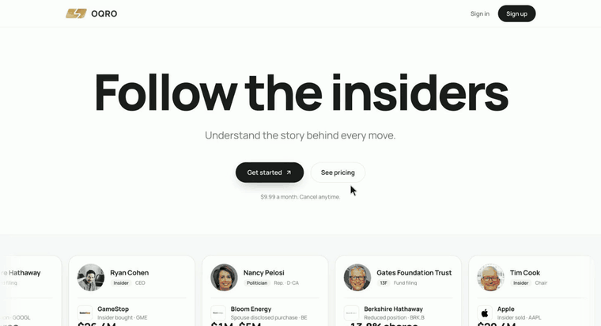

<p align="center"></p>

# OQRO MCP server (free)

A free, remote MCP server for **insider trades, Congress stock trades, hedge fund 13F moves, 8-K events, M&A and federal contracts** on US-listed companies. Ask Claude, ChatGPT, Cursor or any MCP client; every answer comes with the official filing it was read from.

- **Price:** free. All 22 tools, no credit card, no trial that runs out. You sign in with a free OQRO account (an email address is enough).
- **Server (remote, Streamable HTTP):** `https://oqro.io/api/mcp`
- **Website and setup page:** <https://oqro.io/mcp>
- **Protocol:** MCP `2025-06-18`
- **Auth:** OAuth 2.1 with PKCE and dynamic client registration. Every request needs the sign-in: without a token the server answers HTTP 401 and points at its OAuth metadata, so your client opens the OQRO sign-in by itself. The tool list is public in the server card (<https://oqro.io/.well-known/mcp>).
- **Usage:** your tool calls per day are shown in your account, under API keys and usage.

<p align="center"><a href="assets/oqro-demo.mp4"></a></p>
<p align="center"><sub>One-minute tour of the data behind the server. <a href="assets/oqro-demo.mp4">Watch it as a video (MP4)</a>.</sub></p>

OQRO describes what was filed. It is not investment advice.

## Connect

**Claude Code**

```bash
claude mcp add --transport http oqro https://oqro.io/api/mcp
```

**Cursor** (`~/.cursor/mcp.json`)

```json
{ "mcpServers": { "oqro": { "url": "https://oqro.io/api/mcp" } } }
```

**Claude, ChatGPT and other clients:** add a remote MCP server (custom connector) with the URL above, then sign in when asked. Step-by-step screens are on <https://oqro.io/mcp>.

## Tools (22)

| Tool | What it does |
|---|---|
| `search_companies` | Find a covered company by ticker or name. |
| `get_company` | Profile, latest close against the S&P 500, revenue and net income from SEC filings, counts of recent disclosures. |
| `latest_results` | Latest quarter, trailing twelve months, fiscal year and balance sheet from the company's own SEC filings. |
| `pre_mortem` | Measurable facts for a risk review: cash burn, debt, profit trend, dilution, insider buying and red-flag filings. |
| `insider_trades` | Officer, director and 10% owner trades from SEC Form 4, plus Form 144 notices of planned sales. |
| `rare_insider_trades` | Insider trades that stand out against the company's own record since 2006, each with plain-sentence signals. |
| `insider_record` | Open-market purchases and sales per year since 2006 for one company or one person. |
| `congress_trades` | Stock transactions disclosed by members of Congress (House Clerk and Senate), with the official amount ranges. |
| `fund_moves` | Position changes in SEC Form 13F of the managers OQRO follows. |
| `convergence` | Companies where insiders, funds and Congress lean the same way at the same time. |
| `federal_contracts` | Prime federal contract awards mapped to public companies (USAspending.gov). |
| `lobbying` | Federal lobbying spend per quarter from Lobbying Disclosure Act reports. |
| `price_history` | Daily, weekly or monthly closes next to the S&P 500, with drawdown from the high. |
| `screen` | Filter and sort about 850 covered companies on published numbers. |
| `leaderboard` | Members of Congress or insiders ranked by how their disclosed purchases did against the S&P 500. |
| `company_context` | What has been happening at one company: its weekly note written from OQRO's own facts, its Form 8-K reports with the company's own opening sentence, mergers and acquisitions it is part of, and 30 and 90 day price moves. |
| `company_records` | Public records about one company beyond SEC filings: FDA approvals, clearances and recalls, NHTSA vehicle recalls, WARN layoff notices, federal securities cases, clinical trials and CFPB complaint counts by month, each with its date and official source. |
| `compare_companies` | Two covered companies side by side, with the OQRO comparison page. |
| `insider_stats` | Insider buying statistics per year since 2006: purchases, sales, values, who bought, largest purchases, sector view. |
| `congress_stats` | Congress stock trades per year from 2021: trades, members, reporting delay, most-traded stocks and most active members. |
| `baskets` | Disclosure baskets (insider, Congress and fund purchases under a written rule) against the S&P 500, with every member company. |
| `calendar` | Earnings dates, economic releases and SEC filing deadlines for the next 30 days. |

## Example questions

- Which insiders bought their own company's stock on the open market in the last 30 days, and which purchases were the largest?
- Which insider purchases this week stand out against that company's last 20 years of filings?
- Show the politician trades in NVDA over the last year, with the official amount range and the link to each filing.
- What did Berkshire Hathaway add to, trim or exit in its latest 13F?
- Run a pre-mortem on Boeing: free cash flow, debt, dilution and the red-flag filings of the last 12 months.

## What an answer looks like

A real result from `rare_insider_trades`, for the week of November 2, 2026. Your assistant writes the sentences; the facts and links come from the tool.

> **Upbound Group (UPBD).** By November 2, 5 insiders had bought shares on the open market within one week; by November 5 there were 7. No week in UPBD's filings since 2006 had that many buyers, and these were the first open-market purchases by any UPBD insider since May 2025. Among them: Jeffrey J. Brown, about $400,000 (filed November 4), and Glenn P. Marino, about $393,000, Marino's first purchase of UPBD in filings since 2006. [Filing on OQRO](https://oqro.io/e/6578a966-d7b9-5e12-8e9b-d4573b3a82ec)
>
> **LKQ Corporation (LKQ).** Sue Gove bought about $201,000 on November 4, Gove's first open-market purchase of LKQ in filings since 2006. 3 LKQ insiders bought that week, which happened 3 times before since 2006. 5 days later LKQ filed an 8-K about a change of a top executive or board member. [Filing on OQRO](https://oqro.io/e/1688e530-8632-5e7e-8ee6-512b4f3091db)
>
> **AutoZone (AZO).** A sale, for contrast: Jamere Jackson sold about $10.2 million on November 4. Jackson is named in AutoZone's 8-K of October 20, 2026, which reports his resignation as Chief Financial Officer. [Filing on OQRO](https://oqro.io/e/a335b50c-10a0-5cf6-8a3e-d998ddf47a81)

Each OQRO page links on to the SEC Form 4 itself. The same list, refreshed every day, is free without an account: <https://oqro.io/rare-insider-trades> ([JSON](https://oqro.io/rare-insider-trades/data.json)).

## Sources

SEC EDGAR (Forms 4, 5, 144, 13F, 8-K, Schedules 13D and 13G), House and Senate periodic transaction reports, USAspending.gov, Lobbying Disclosure Act reports. Every record links to its source document.

## What is free

Everything the server returns is also on the website, free and without an account: every company, insider, member of Congress and fund page with the full history, the screener, statistics and track records. A free account adds the MCP server, a REST API key, alerts, watchlists and CSV exports. The one paid option on OQRO is the AI assistant on the website (OQRO Pro); the MCP server does not need it, since your own assistant does the asking. Details: <https://oqro.io/pricing>.

- Rare insider trades, this week: <https://oqro.io/rare-insider-trades>
- Weekly recap of insider and Congress trades: <https://oqro.io/weekly>
- Market map of the S&P 500, today: <https://oqro.io/app/market-update>

## Limits

Filings can arrive late (the trade date can be weeks before the filing date; both are shown). Senate paper filings are read by OCR and can be incomplete. Coverage and freshness per source are on <https://oqro.io/status>.

## More

- OQRO overview, REST API guide and social networks: <https://github.com/LdwS123/oqro-io>
- X [@oqrofinance](https://x.com/oqrofinance), [LinkedIn](https://www.linkedin.com/company/oqro/), [Instagram](https://www.instagram.com/oqrofinance/)
- Built something with it, or found a gap? Post it in [Discussions](https://github.com/LdwS123/oqro-mcp/discussions). If the server is useful to you, a star on this repository helps other people find it.

## Security

The server is read-only and stateless, and every request needs a signed-in account. To report a vulnerability, follow [SECURITY.md](SECURITY.md) (contact@oqro.io; also at <https://oqro.io/.well-known/security.txt>).

## License

The files in this repository are MIT licensed ([LICENSE](LICENSE)). The OQRO service, its data and its logo are not covered by that license: see <https://oqro.io/terms>.
